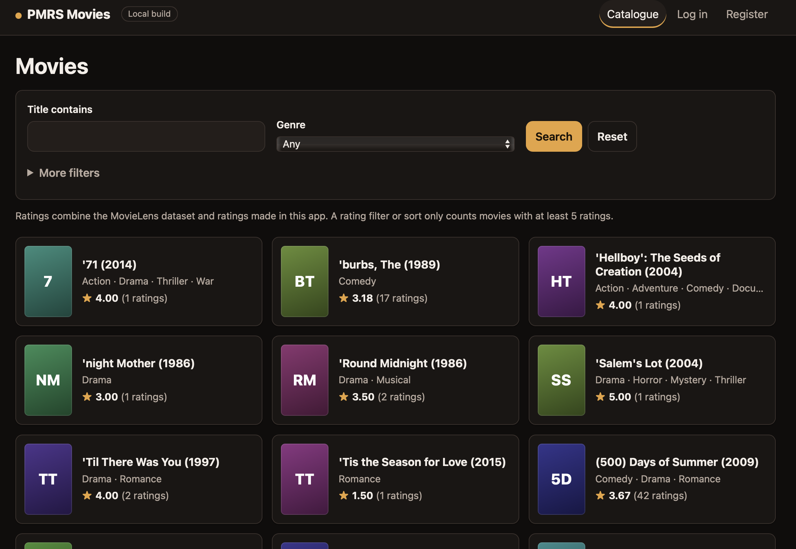
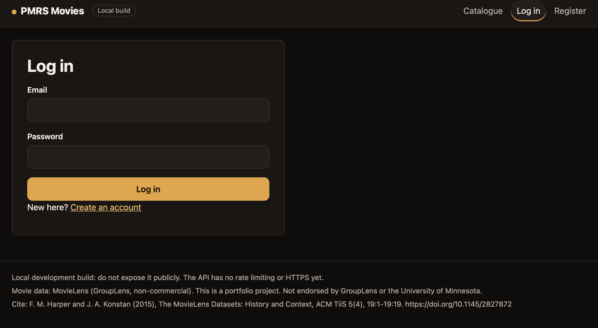

# PMRS: Personalized Movie Recommendation System

PMRS is a local movie app where you can browse films, rate them, and get recommendations with a short explanation of how they were chosen. I built it as a solo portfolio project to explore the full path from recommendation models to a working web app.

**Version 1 is local-only.** There is no hosted demo or public app URL. You can run it on your own machine with Docker after preparing the MovieLens data and model artifact.

| Project status | |
|---|---|
| Local Docker app | Run and checked on one Apple silicon Mac; 11-check app walkthrough passed. Not tested on Linux or Windows. |
| Hosted demo | None. Public hosting was deferred for V1. |
| Evaluation | Offline comparison on MovieLens `ml-latest-small`; see [Results](#offline-evaluation-results). |
| CI | The owner reported a GitHub Actions pass after the final changes. Tests needing local data are skipped in CI, not counted as passed. |
| Code licence | None. The code is public, but no reuse licence has been chosen. |
| V1 status | Closed on 2026-11-12 as a local-only release. |

## What you can do

- Browse a catalogue of 9,742 movies, search by title, and filter by genre, year, or rating.
- Create an account, choose favourite genres, rate movies, and use a watchlist and history.
- Compare recommendation methods: hybrid, SVD, item-kNN, content-based, and popularity.
- See a short explanation alongside recommendations.
- Use a seven-panel dashboard and a login-only analytics page.

The app records when a recommendation was **served** (returned by the API), which does not necessarily mean someone saw it. It also records an **acted** event when a person rates, likes, dislikes, or changes the watchlist or watched status for a served movie. These events do not show that recommendations caused an action.

## Screenshots

These show the local app, not a hosted demo. The generated posters are placeholders, not movie artwork.



*The catalogue includes MovieLens data and ratings made in the app.*



*The footer includes the MovieLens attribution, citation, and non-endorsement notice.*

## Run it locally with Docker

### Before you start

You need:

- Docker with Compose v2.
- About 3 GiB of free disk for the first build, Docker cache, and database volume.
- Python 3.12 and [uv](https://docs.astral.sh/uv/) to download the dataset and build the model artifact.
- The MovieLens dataset and the model artifact prepared below.

This setup was tested on macOS with Apple silicon. The app and API listen on `127.0.0.1`.

### 1. Prepare the data and model artifact

From the repository root:

```bash
uv sync
uv run python -m pmrs.data.download
mkdir -p data/processed/tuning
cp docs/frozen_config.json data/processed/tuning/proposed_frozen_config.json
uv run python -m pmrs.evaluation.serving build
```

The download fetches MovieLens `ml-latest-small` from GroupLens. The build creates `evaluated_step16` and `serving_all_data`; it does not calculate evaluation metrics. The app uses `serving_all_data`. Step 16’s evaluation numbers apply only to the separate `evaluated_step16` fit.

The frozen configuration contains settings, weights, routing, provenance notes, a random seed, and hashes. It does not contain the dataset or a fitted model. The build checks the configuration hash and refuses to overwrite an existing artifact folder.

### 2. Set up and start the app

Copy `.env.example` to `.env` and fill in `POSTGRES_USER`, `POSTGRES_PASSWORD`, `POSTGRES_DB`, and `JWT_SECRET`. Use only letters and digits in the database password. `JWT_SECRET` must be at least 32 characters; you can generate one with:

```bash
python -c "import secrets; print(secrets.token_urlsafe(48))"
```

The `.env` file is git-ignored. Do not commit it or put its values in an image.

Then start the app:

```bash
docker compose -f compose.app.yaml up --build
```

Wait for the migration job to report `verified: database equals the dataset` and for the API to become healthy. Open [http://localhost:8080](http://localhost:8080), register with an email address you are comfortable storing locally, choose a few genres, and start rating movies.

The first Docker build takes several minutes. Later starts are faster.

To stop the app and keep its database:

```bash
docker compose -f compose.app.yaml down
```

To stop the app and delete this stack’s database volume and local accounts:

```bash
docker compose -f compose.app.yaml down -v
```

### Notes about the local stack

- It has its own database volume and does not use the separate development database.
- If port 8000 or 8080 is busy, set `API_PORT` or `WEB_PORT` and rebuild. For example: `WEB_PORT=8090 docker compose -f compose.app.yaml up --build`.
- Data and model files are mounted read-only; they are not copied into the images. The images contain no `.env` or secrets and run as non-root users.
- Measured image sizes on the project Mac: API about 636 MB on disk (about 131 MB compressed), web about 93 MB (about 26 MB compressed).

## How recommendations work

The system uses several methods so their results can be compared:

- **Popularity** recommends movies with strong rating support.
- **Content-based** recommendations use movie genres, titles, and available tags.
- **Item-kNN** looks for movies rated similarly by the same users.
- **SVD** learns compact patterns from the user–movie rating matrix.
- **Hybrid** combines several methods for users with enough rating history.

The app routes by the number of ratings available: with no ratings, it uses a genre/popularity mix; with 1–10 ratings, it uses popularity; with 11 or more, it uses the full hybrid. Exactly 11 ratings was not evaluated.

The app’s explanation is a plain-language description of evidence used by the selected method. It is not proof that a person will like the movie.

## Offline evaluation results

The models were compared on MovieLens `ml-latest-small` using the same per-user holdout protocol. For 453 warm users, the main metric was NDCG@10. It measures whether relevant movies appear near the top of a recommendation list; higher is better.

| Method | NDCG@10 |
|---|---:|
| Hybrid | **0.064** [0.052, 0.077] |
| SVD | 0.055 |
| Popularity | 0.047 |
| Bayesian average | 0.032 |
| Item-kNN | 0.021 |
| Content-based | 0.007 |
| Random | 0.002 |

The hybrid scored 0.017 above popularity, with a 95% interval of [0.006, 0.029]. Its lead over SVD was smaller: 0.009 [0.001, 0.017].

These are modest scores: most top-10 lists contained no movie that the user had rated highly. The results support a comparison of methods under this particular protocol and dataset. They do **not** establish leakage-safe future prediction: models were fitted once and could use other users’ later ratings and tags. The intervals describe sampling noise between users only.

The app serves `serving_all_data`, which was fitted on all the data and has **no quality metric of its own**. The figures above apply only to the separate `evaluated_step16` fit. The cold-start results are a simulation, not evidence about real new users. See [docs/evaluation.md](docs/evaluation.md) and [MODEL_CARD.md](MODEL_CARD.md) for details.

## Architecture

The React 19, TypeScript, and Vite frontend calls the FastAPI backend. The backend stores accounts, movies, ratings, and interactions in PostgreSQL, with SQLAlchemy and Alembic migrations.

At startup, the API loads a frozen model artifact and checks its SHA-256 manifest. The recommender package is separate from the web app and is shared by the evaluation code.

## Run from source for development

For development, you need Python 3.12, `uv`, Node 22+, and Docker for PostgreSQL. Start the API and frontend in separate terminals.

First, prepare `.env`, install the Python dependencies, download the dataset, and initialize the database:

```bash
cp .env.example .env
uv sync
uv run python -m pmrs.data.download
docker compose up -d db
uv run alembic upgrade head
uv run python -m pmrs.db.seed
```

The development `.env` also needs `DATABASE_URL` and `TEST_DATABASE_URL` for tests. `FRONTEND_ORIGIN` is optional.

In one terminal, start the API:

```bash
uv run uvicorn pmrs.api.app:create_app --factory
```

In another terminal, start the frontend:

```bash
cd frontend
npm install --no-audit
npm run dev
```

Use `localhost` for the frontend address; the API allows one configured origin.

## Why there is no hosted demo

V1 has no public deployment. The project was kept within a $0 hosting budget, and public exposure would need more work.

The API was tested locally with a 512 MB memory limit, swap disabled, and 0.1 CPU. Eight simultaneous registrations caused it to be killed for exceeding memory; under the same constrained setup, startup took about 3.7–4 minutes. This is a local test, not a measurement of Render or another hosting provider.

The API also needs public-facing protections before it should be exposed: login throttling, a cap on concurrent password hashing, HTTPS, token revocation, and a password check for account deletion. The MovieLens non-commercial terms and redistribution of data or fitted models also remain unresolved for the project owner.

Render was not tested. See [docs/hosting-gate.md](docs/hosting-gate.md) for the conditions a future deployment would need to meet.

## Checks and continuous integration

The last full local runs recorded 294 passing backend tests and 76 passing frontend tests. Run the checks with:

```bash
uv run ruff check
uv run ruff format --check
uv run mypy
uv run pytest

cd frontend
npm run typecheck
npm run lint
npm run format:check
npm test
npm run build
```

The owner reported that GitHub Actions passed after the final changes. That run has not been independently checked here. A fresh CI checkout has no MovieLens data or model artifact, so 17 data-dependent tests skip there rather than pass: 16 recommendation API tests and one download test. CI therefore does not exercise real recommendations through the API.

The artifact rebuild was verified once on the project Mac in a clean copy using local MovieLens files and an existing Python environment. The rebuilt artifacts passed manifest, configuration-hash, and loading checks. Across 1,200 sampled recommendations per artifact, the rebuilt and original models returned identical lists and scores. The rebuilt model files were not byte-identical, and the check did not include a fresh `uv sync` or dataset download.

## Known limits

- The project is local-only and was tested on one Mac with Apple silicon, not on Linux or Windows.
- There was no load, security, or many-user testing beyond the local memory test described above.
- There is no login throttling or HTTPS; `/docs` is enabled, tokens cannot be revoked, and account deletion does not ask for a password. Do not expose the API publicly.
- The browser stores its token in `sessionStorage`.
- The dataset is small and development-grade; it contains no real app users.
- Recommendations are popularity-heavy, and exactly 11 ratings was not evaluated.
- A `.joblib` model artifact is a pickle. Load only artifacts built by this project; the manifest detects changes but does not make an untrusted pickle safe.

## Data, citation, and attribution

The project uses MovieLens `ml-latest-small`, from GroupLens at the University of Minnesota. The dataset is not included in this repository; the download command fetches it from GroupLens. The app also shows the required attribution and citation in its footer.

MovieLens is licensed for non-commercial use. Whether a portfolio project counts as non-commercial is an open question for the project owner. Do not use this project for commercial or revenue-generating purposes. Read the dataset README and terms before use. This project is not endorsed by GroupLens or the University of Minnesota.

Please cite:

> F. Maxwell Harper and Joseph A. Konstan. 2015. The MovieLens Datasets: History and Context.  
> ACM Transactions on Interactive Intelligent Systems (TiiS) 5, 4: 19:1–19:19.  
> <https://doi.org/10.1145/2827872>

## Project documents

- [Model card](MODEL_CARD.md): intended use, model details, results, and limitations.
- [Scope](SCOPE.md): what V1 includes and defers.
- [Evaluation report](docs/evaluation.md): methods, results, and caveats.
- [Hosting gate](docs/hosting-gate.md): requirements for considering a hosted version.
- [Decision log](DECISIONS.md): project decisions.
- [Frozen configuration](docs/frozen_config.json): settings used to reproduce the model build.

## Licence

The project code has no licence granting reuse rights. The repository is public, but that does not grant permission to copy, modify, or redistribute the code. MovieLens data has separate terms described above.
